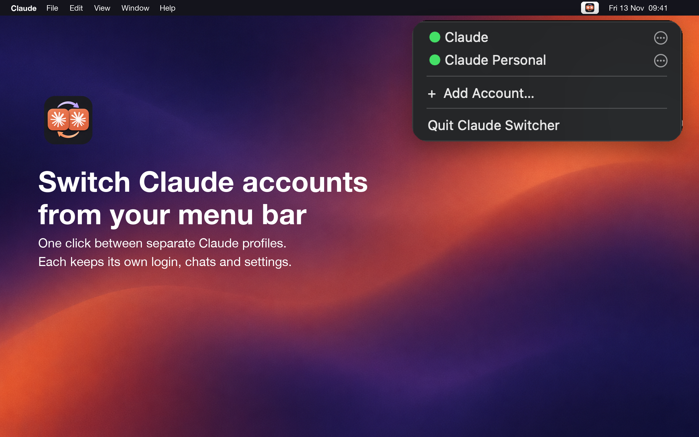
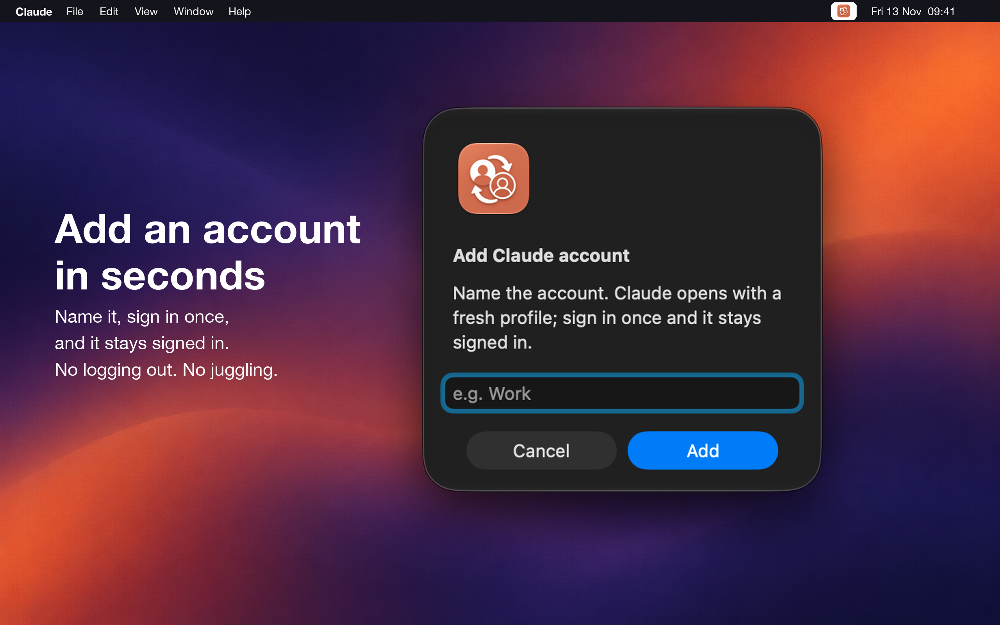
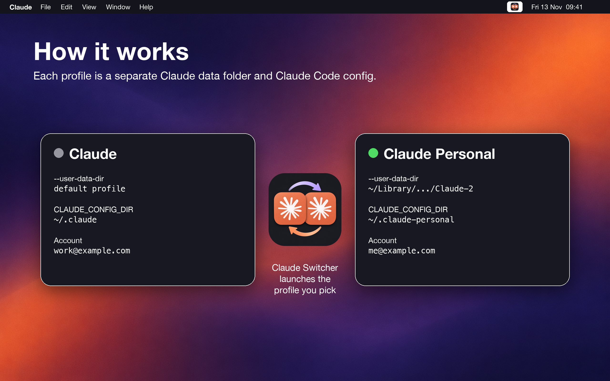

# Claude Switcher

A tiny macOS menu-bar app to switch between multiple Claude desktop profiles (separate accounts), each with its own `--user-data-dir` and `CLAUDE_CONFIG_DIR`.

<p align="center">
  
</p>
<p align="center">
  
</p>
<p align="center">
  
</p>

## Install

Download `ClaudeSwitcher.zip` from [Releases](https://github.com/trmquang93/ClaudeSwitcher/releases), unzip, and move `Claude Switcher.app` to Applications. Apple Silicon only. The app is ad-hoc signed, not notarized: on first launch, right-click it and choose Open (or run `xattr -dr com.apple.quarantine "Claude Switcher.app"`).

Requires macOS 13+ and `/Applications/Claude.app`.

## Build

Requires Xcode command line tools.

```sh
./build.sh
```

Installs `~/Applications/Claude Switcher.app`, ad-hoc signed. Set `CODESIGN_IDENTITY` to sign with your own identity.

## Profiles

Stored in `~/Library/Application Support/ClaudeSwitcher/accounts.json`. Add, rename and remove profiles from the menu.

## scripts/

`cleanup_archived_sessions.py`: delete Claude Code desktop sessions archived longer than N days.

Not affiliated with Anthropic.
